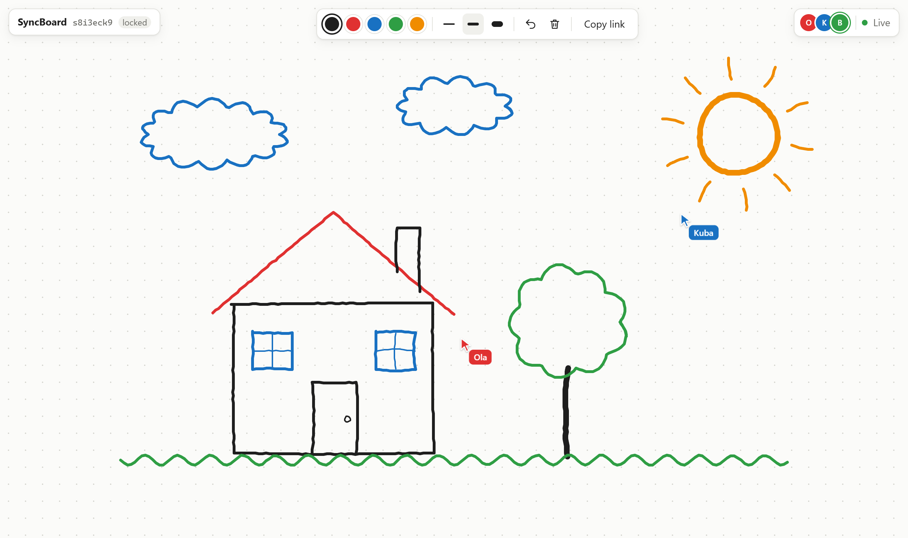
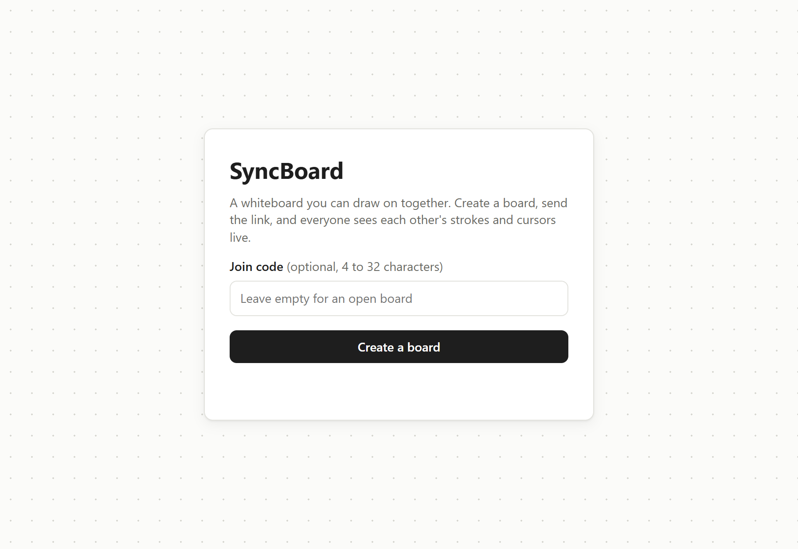
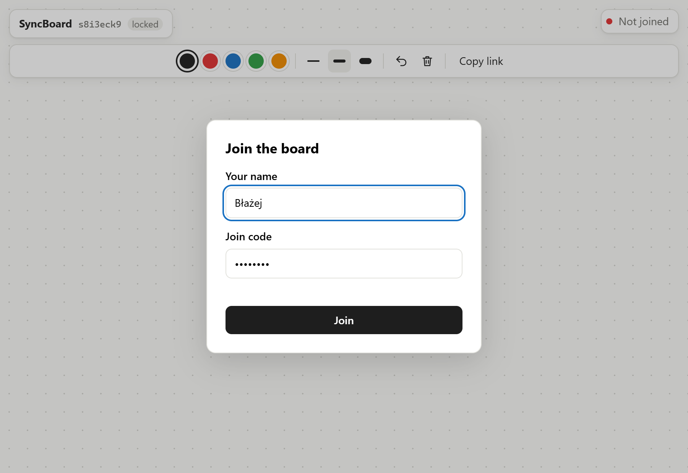

# SyncBoard

[](https://github.com/zitreF/syncboard/actions/workflows/build.yml)

A small real-time whiteboard. Create a board, send the link to friends (optionally protected with a join code) and
draw together: everyone sees the others' strokes and cursors as they happen.



## Features

- **Boards with a link.** One click creates a board with a short random id, for example `/r/s8i3eck9`. Anyone with the
  link can join.
- **Optional join code.** A board can be locked with a code of 4 to 32 characters. Without it the server refuses to
  let anyone in.
- **Live drawing.** Five colors, three widths. Others see a line grow while it is being drawn, not only after the
  mouse is released.
- **Live cursors and people.** Everyone's cursor moves on the board with their name next to it, and the top right
  corner shows who is on the board.
- **Undo and clear.** `Ctrl+Z` removes your own last stroke, the trash icon clears the board for everyone.
- **Late joiners and reconnects.** Someone who joins later gets everything drawn so far. A page that loses the
  connection reconnects on its own and gets the current board again.

<p>
  
  
</p>

## Running

Java 25 is the only requirement. Gradle comes with the wrapper.

```bash
./gradlew bootRun
```

Open http://localhost:8080, create a board and open its link in another tab or browser. To build a single jar and run
it on another port:

```bash
./gradlew bootJar
PORT=9000 java -jar build/libs/syncboard.jar
```

Settings in `src/main/resources/application.yml`:

| Setting                       | Default | Meaning                                         |
|-------------------------------|---------|-------------------------------------------------|
| `server.port` (env `PORT`)    | `8080`  | HTTP and WebSocket port                         |
| `syncboard.max-rooms`         | `1000`  | how many boards may exist at the same time      |
| `syncboard.room-idle-timeout` | `30m`   | how long an empty board is kept before removal  |
| `syncboard.cleanup-interval`  | `1m`    | how often empty boards are looked for           |

## How it works

The server is a Spring Boot app with one REST controller and one WebSocket handler (`TextWebSocketHandler`, no STOMP).
The page is plain HTML, CSS and JavaScript served by the same app, drawn on a `<canvas>`, with no framework and no
build step.

1. `POST /api/rooms` creates a room with a random 8-character id and an optional join code.
   `GET /api/rooms/{id}` tells the page whether the room exists and whether it needs a code.
2. The page opens a WebSocket to `/ws/rooms/{id}` and sends `join` with a name and the code. The server answers with
   `welcome`: everything drawn so far and who is on the board.
3. While you draw, the page collects points and sends the new ones every 40 ms as a `draw` message with the stroke's
   id. The server appends them to the stroke and passes them on to everyone else.
4. `erase` (undo) and `clear` work the same way. Cursor positions are sent at most every 40 ms and are only passed
   on, never stored.

| Page → server                     | Server → page                                    |
|-----------------------------------|--------------------------------------------------|
| `join {name, code}`               | `welcome {you, members, strokes}`                |
| `draw {id, color, width, points}` | `draw`, `erase`, `clear {by}` from the others    |
| `erase {id}`, `clear`             | `members {members}` when someone joins or leaves |
| `cursor {x, y}`                   | `cursor {member, x, y}`                          |
|                                   | `notice {message}`, e.g. when the board is full  |

When something is wrong the server closes the socket with a code the page understands: `4403` wrong join code,
`4404` no such board, `4409` board full (20 people), `4400` a message that breaks the rules. A client that falls too
far behind gets `1013` and the page simply reconnects.

A few decisions worth knowing:

- **One queue per room, no locks.** Each room has its own task queue worked off by a single virtual thread
  (`Room.execute`). The WebSocket handler never touches a room directly, it only queues work for it, so a room's state
  is only ever changed by one thread and needs no `synchronized` or `Lock`. Changes and the messages about them go out
  in queue order, so every page sees them in the same order as the server. Rooms never wait for each other.
- **One outbox per connection.** The room thread does not write to sockets itself: it drops each message into the
  connection's `Outbox`, a bounded queue with its own virtual thread. A client whose connection stalls cannot hold up
  its room; once it is 1000 messages behind it is disconnected.
- **Nothing from the client is trusted.** Colors, widths, coordinates and ids are checked, a board holds at most
  10 000 strokes, and names are cleaned on the server and only ever put on the page as text.
- **Boards live in memory.** That keeps the project small. The trade-off: restarting the server empties every board,
  and one instance is the limit.

## Tests

```bash
./gradlew build
```

- `RoomTest`, `RoomServiceTest`: strokes, undo and clear, join codes, member colors, limits, name cleaning,
  removing empty boards (with a fake clock), and the room queue: tasks run in order on one thread, and 20 people
  drawing into one stroke at the same time lose no points.
- `ClientMessageTest`: which `draw` and `cursor` messages are accepted.
- `OutboxTest`: messages go out in order, and a stalled client is closed without making the room wait.
- `BoardSocketTest`: starts the app on a random port and talks to it with real WebSocket clients (JDK `HttpClient`):
  two people drawing, a late joiner, undo and clear, members and cursors, locked boards, unknown boards and malformed
  messages.

GitHub Actions runs the same build on every push.

## Project layout

The code is organised by feature: each top-level package is one thing the app does, and holds everything that thing
needs, from the model to the endpoint. A new feature gets its own package next to these.

```
src/main/java/me/fertiz/syncboard
    SyncBoardApplication        starts the app
    room/                       rooms: creating, finding and expiring them, their strokes and members
        dto/                    what the REST API takes and returns (CreateRoomRequest, RoomResponse)
        Room, Member, Stroke    the state of one room
        RoomService             keeps all rooms, removes empty ones
        RoomController          POST /api/rooms, GET /api/rooms/{id}
        RoomPageController      serves the board page at /r/{id}
    board/                      drawing together live over WebSocket
        message/                what the page and the server send each other (ClientMessage, ServerMessage)
        BoardSocketHandler      joins people to rooms and passes changes on
        Outbox                  one send queue per connection
        SocketConfig            registers /ws/rooms/{id}
src/main/resources/static
    index.html, board.html      the home page and the board
    js/                         home.js, board.js (drawing, sync, cursors), storage.js
    css/                        style.css
```

Tests use the same packages. `BoardSocketTest` in the root package starts the whole app.

## Stack

Java 25, Spring Boot 4.1 (Web MVC, WebSocket), Jackson, JUnit and AssertJ, plain JavaScript with Canvas 2D, Gradle
with the Kotlin DSL.
